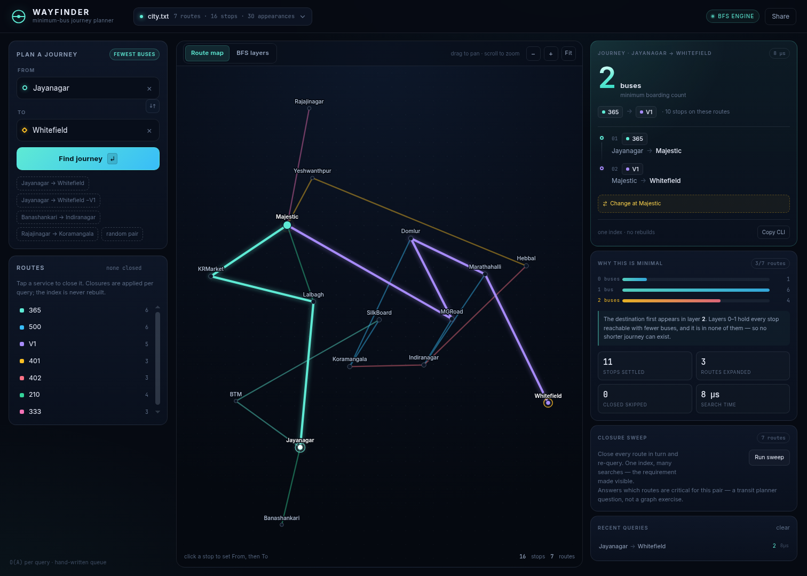

# The City That Couldn't Find Its Way

**Problem Statement 10 — Graph Traversal and Route Planning**
Data Structures and its Applications (1BCS305), Dayananda Sagar College of Engineering

A city has many overlapping bus routes, and temporary closures make familiar
paths unreliable. This project is a **journey planner** that:

- finds a journey using the **minimum number of buses** (not the minimum stops),
- shows the ordered routes and the stop where you change buses,
- respects **inactive routes** on a per-query basis,
- answers **repeated queries** on the same network without rebuilding its index.



## See it in the browser

```bash
make          # batch CLI + optional UI server
make serve    # http://127.0.0.1:8080
```

The UI is a thin front-end over the same C++ search: the browser sends a query,
`src/server.cpp` calls `find_journey_stats()`, and the page draws the answer. It
adds a route map, an animated journey, a **BFS layer view** that shows why the
answer is minimal, per-route closure toggles, a **closure sweep** that re-queries
once per route on the same index, and a network dialog for pasting an unseen
input. No framework, no CDN, no build step; it works offline.

The graded batch mode is unchanged:

```bash
./build/journey < samples/example1.txt   # byte-exact, see docs/CONTRACT.md
```

Details: [docs/UI.md](docs/UI.md).

## Pick your role

All three roles are equal in weight. Comment **mine** on that role's issue
([#1](https://github.com/karthiknk7019/DSCE_AAT/issues/1),
[#2](https://github.com/karthiknk7019/DSCE_AAT/issues/2),
[#3](https://github.com/karthiknk7019/DSCE_AAT/issues/3)) to claim it, then read
[docs/ROLES.md](docs/ROLES.md) for the full task list.

| Role | You own | Files | Pick it if you like |
|---|---|---|---|
| **1 — Core algorithm** — [claim #1](https://github.com/karthiknk7019/DSCE_AAT/issues/1) | stop index + minimum-bus BFS | `src/graph.cpp` | algorithms, complexity, the "why BFS" questions |
| **2 — CLI & I/O** — [claim #2](https://github.com/karthiknk7019/DSCE_AAT/issues/2) | input parsing, output format, query loop | `src/cli.cpp`, `src/main.cpp` | making the tool usable and demo-ready |
| **3 — Tests, perf & demo** — [claim #3](https://github.com/karthiknk7019/DSCE_AAT/issues/3) | test suite, worst-case generator, demo script | `tests/`, `tools/`, `docs/DEMO-SCRIPT.md` | breaking things, proving correctness |

> Every member must be able to **explain their own code** in the viva. The
> classroom rules allow AI tools, but "the AI wrote it" is not an explanation.
> See [docs/COURSE-MAPPING.md](docs/COURSE-MAPPING.md) for the course concepts
> behind each role.

## Quick start

```bash
make                              # build build/journey (CLI + optional server)
make run                          # the problem statement's example
./build/journey samples/demo.txt  # or pass any batch input file directly
make test                         # 15-case matrix + perf check
make serve                        # browser UI at http://127.0.0.1:8080
bash tools/smoke.sh               # byte-exact diff for every sample
bash tools/ui_smoke.sh            # build -> query -> closure -> sweep over HTTP
```

Enter a query by hand (interactive extension):

```bash
./build/journey --interactive samples/city.txt
# From: Jayanagar
# To:   Whitefield
# Closed routes (space separated, blank = none):
# -> JOURNEY 2 buses: 210 to Majestic, then V1 to Whitefield
```

Input format and exact output: [docs/CONTRACT.md](docs/CONTRACT.md).

## Sample networks

| File | What it is |
|---|---|
| `samples/example1.txt` | the problem statement's illustrative example |
| `samples/demo.txt` | 2 buses / 10 stops beats 3 buses / 4 stops |
| `samples/city.txt` | small Bengaluru-style network with named stops |
| `samples/city-large.txt` | 400 routes, 34,903 stop appearances, 2,001 numeric stops, 100 queries |
| `samples/expected-*.txt` | exact stdout for each sample |

Stops and route names are arbitrary tokens, so numeric IDs (`1`..`2000`) work
exactly like names. `make gen` writes a separate 400-route / 40,000-appearance
stress input to `samples/big.txt` (gitignored) for performance runs.

## Repo map

```
include/journey.hpp   frozen interface shared by all three roles
include/stats.hpp     optional per-query instrumentation for the UI
include/server.hpp    ServerOptions for the optional browser front-end
src/graph.cpp         Role 1: build_network, find_journey, find_journey_stats
src/cli.cpp           Role 2: run_cli (parse -> build once -> answer queries)
src/main.cpp          Role 2: entry point (batch, interactive, --serve)
src/server.cpp        local HTTP + JSON API, POSIX sockets only
tests/                Role 3: dependency-free tests (make test)
tools/gen_network.cpp Role 3: 400-route / 40,000-appearance generator
tools/ui_smoke.sh     Role 3: end-to-end API check for the browser UI
web/                  single-page UI: no framework, no CDN, no build step
samples/              example, demo and expected outputs
docs/                 contract, roles, decisions, UI, course mapping, demo
```

## Ground rules (from the course announcement)

- AI tools are allowed, but **shortcuts / built-in functions that directly
  solve the core problem are not**. We hand-write the BFS queue and the graph
  index; no Boost, no library graph algorithms.
- Every member must be ready to demonstrate and explain their individual
  contribution.
- Individual contribution and quality are graded, so commits and PRs must show
  who did what.
- Scope limit: up to **400 routes** and **40,000 stop appearances**.

## Build order (what depends on what)

Work is parallel, not sequential — but these are the real dependencies:

1. **Setup** — roles claimed, all three have push access, contract read,
   branch protection on.
2. **Tests first** — Role 3 writes the failing cases from the contract. They
   define "done" for everyone else.
3. **In parallel** — Role 1 implements the BFS; Role 2 implements the CLI;
   Role 3 expands the test matrix and the generator.
4. **Integrate** — `make test` green on `main`, run the sample and demo.
5. **Prove it** — worst-case network, then rehearse the demo until all three
   can explain every design choice without notes.

## Docs

| File | What it is |
|---|---|
| [docs/CONTRACT.md](docs/CONTRACT.md) | input/output spec and API semantics — **read first** |
| [docs/UI.md](docs/UI.md) | the browser front-end: API, BFS layer view, demo path |
| [docs/UI-ROLES.md](docs/UI-ROLES.md) | UI ownership, architecture, extension recipes, backlog |
| [docs/HANDOFF.md](docs/HANDOFF.md) | current state, verification commands, known gaps |
| [docs/ROLES.md](docs/ROLES.md) | what each role builds, step by step |
| [docs/CONTRIBUTING.md](docs/CONTRIBUTING.md) | branches, PRs, reviews, AI rules |
| [docs/DECISIONS.md](docs/DECISIONS.md) | why we chose each design (viva ammo) |
| [docs/COURSE-MAPPING.md](docs/COURSE-MAPPING.md) | which module each part comes from |
| [docs/DEMO-SCRIPT.md](docs/DEMO-SCRIPT.md) | minute-by-minute demo with expected output |
| [AGENTS.md](AGENTS.md) | rules for any AI assistant working in this repo |

## Current status

- [x] Interface frozen, skeleton compiles (`make`)
- [x] Sample + demo inputs and expected outputs
- [x] Tests written for the problem statement's cases
- [x] Role 1: minimum-bus BFS
- [x] Role 2: parser + output
- [x] Role 3: full test matrix + perf generator
- [x] Browser UI: route map, BFS layer view, closure sweep, network paste
- [ ] Demo rehearsed by all three
