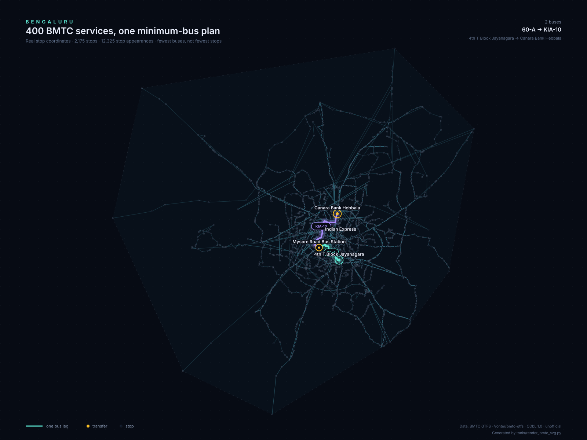

# Real Bengaluru bus data

The synthetic samples are useful for tests, but a demo lands differently when
the stop names are real. This page documents the real BMTC sample that ships in
`samples/bmtc.txt`, the coordinates in `web/data/bmtc.json`, and how to
regenerate or extend them.

## Source

| | |
|---|---|
| Dataset | unofficial BMTC GTFS (routes, stops, timetables) |
| Repository | <https://github.com/Vonter/bmtc-gtfs> |
| Licence | **ODbL 1.0** (Open Database License) |
| Attribution | "BMTC GTFS data by Vonter/bmtc-gtfs, ODbL 1.0" |
| Files used | `csv/routes.csv` (~7 MB) and `geojson/stops.geojson` (~27 MB) |
| Caveat | Unofficial, scraped from the Namma BMTC app. Timetables are known to be imperfect; this project only uses route order and stop coordinates. |

The DSA program does not read the GTFS at runtime. The data is converted once
and committed as ordinary contract input, so the demo still works offline.



## What was selected

- **400 route numbers** — the busiest by total trips across both directions.
  One direction per route number, choosing the pattern with the most stops for
  map coverage.
- **12,325 stop appearances**, well under the 40,000 limit.
- **2,175 unique stops**, all with coordinates.
- **239 KB** of input, **183 KB** of coordinates; the whole sample answers its
  four queries in ~10 ms on the demo laptop.
- Stop names are single tokens (`Kempegowda_Bus_Station(Majestic/KBS)`), because
  the contract splits on whitespace. `web/data/bmtc.json` keeps the original
  names for display.

The four checked-in demo queries:

| Query | Result |
|---|---|
| Jayanagar → Hebbal (nearest served stops) | 2 buses: `60-A` + `KIA-10` |
| Kempegowda Bus Station → Airport | 1 bus: `KIA-9` |
| Banashankari 6th Phase → Marathahalli | 3 buses: `MF-34`, `226-N`, `333-E` |
| Kempegowda Bus Station → Electronic City | 1 bus: `349-C` |

These are real route numbers, but they are not a timetable recommendation. The
planner only minimises boardings.

## Files

```
samples/bmtc.txt              contract input: 400 routes + 4 query lines
samples/expected-bmtc.txt     byte-exact CLI output, wired into tools/smoke.sh
samples/bmtc.manifest.json    SHA-256 checksums + source, licence & date provenance
web/data/bmtc.json            stop coordinates + display names + hubs + licence
tools/import_bmtc.py          converter (Python 3 standard library only)
tools/refresh_bmtc.py         refresh + checksum/provenance check (--check / --update-manifest)
tools/render_bmtc_svg.py      standalone map for README/slides/fallback
tools/check_bmtc.py           format, coverage, query and leg-chain checks
docs/bmtc-map.svg / .png      the generated map
```

`bmtc.json` shape:

```json
{
  "city": "Bengaluru",
  "source": "https://github.com/Vonter/bmtc-gtfs",
  "license": "ODbL 1.0",
  "center": [77.5946, 12.9716],
  "stops": { "stop_token": [longitude, latitude] },
  "display": { "stop_token": "Original Stop Name" },
  "hubs": [ { "stop": "stop_token", "routes": 12 } ]
}
```

`web/data/` is served as a static directory by `journey --serve`, so no API
change is needed for coordinates.

## Regenerate

```bash
make data    # download/cache, rewrite the sample, map and expected output
```

or step by step:

```bash
python3 tools/import_bmtc.py
python3 tools/render_bmtc_svg.py
./build/journey < samples/bmtc.txt > samples/expected-bmtc.txt
python3 tools/check_bmtc.py
python3 tools/refresh_bmtc.py --check
bash tools/smoke.sh
```

Options:

```bash
python3 tools/import_bmtc.py --limit 300 --max-appearances 30000
python3 tools/import_bmtc.py --routes /path/routes.csv --stops /path/stops.geojson
```

The script needs network access only when the cached files are missing. It uses
`urllib` and no third-party packages, so it works on a lab machine.

## Conversion rules (and what they cost)

1. **One direction per route number.** GTFS has UP and DOWN patterns; the
   contract has one route name. We keep the longer pattern and treat routes as
   undirected, exactly as `docs/CONTRACT.md` requires. This means the planner
   may ride "against" the listed order — which the problem statement explicitly
   allows. Consequence: a few real one-way loops are more permissive than the
   true service.
2. **Busiest 400 by trip count.** This keeps the map recognisable (500, 365,
   KIA-9, etc.) but drops low-frequency services. A larger sample would need a
   different selection policy, not a contract change.
3. **Stop tokens.** Whitespace becomes `_`; collisions get `_2`. The original
   name is preserved in `bmtc.json` for the UI and for attribution.
4. **No shapes.** The map draws routes through stop coordinates, not the GTFS
   road geometry. Real shapes are the obvious next visual upgrade; see the task
   list in `docs/UI-ROLES.md`.
5. **No timetables, fares or frequencies.** Out of scope by the problem
   statement. The GTFS times are not used.

## UI map mode (in progress)

The intended behaviour:

- `samples/bmtc.txt` is offered as **Bengaluru · real BMTC** in the network
  dialog;
- the page fetches `/data/bmtc.json`, projects lon/lat with a local
  equirectangular projection (`x` scaled by `cos(latitude)`), and fits the city
  to the canvas;
- routes are drawn through their real stop coordinates over a faint convex
  hull, with a "BENGALURU" caption;
- stop labels come from `display` (pretty names), while queries and the CLI
  contract keep using tokens;
- the map caption carries the BMTC GTFS / ODbL attribution.

The data and the wiring are in the working tree. The UI owner is finishing the
visual pass; verify it at 1512×950 and 760×1000 before relying on it in the
demo. The CLI path is already verified by `tools/smoke.sh`.

## Attribution

If the real sample or its coordinates are shown (screenshot, demo, README), keep
the attribution visible:

> BMTC GTFS data by [Vonter/bmtc-gtfs](https://github.com/Vonter/bmtc-gtfs),
> ODbL 1.0. Not affiliated with BMTC.

Screenshots in `docs/` include the caption; the dataset is unofficial and the
route numbers are not a service guarantee.

## Tasks for the team

The detailed backlog is in `docs/UI-ROLES.md` under "Real data". The short list:

- verify the geo map on the demo machine (blocking for Act 2c);
- fetch and simplify GTFS `shapes.txt` (or `geojson/routes.geojson`) so routes
  follow roads instead of straight lines between stops;
- add a scale bar, north arrow and a handful of landmark labels;
- add a data-refresh script with a checksum so the sample is reproducible;
- decide whether to show both directions of a route (needs a contract
  discussion — the frozen grammar has one name per route);
- add a small "data & licence" panel with the attribution and generation date.
