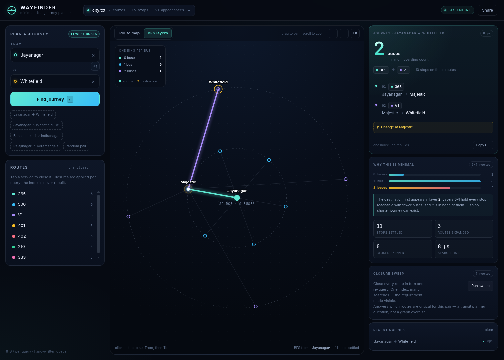

# Wayfinder — the browser front-end

The graded deliverable is still the batch CLI (`./build/journey` reading
`docs/CONTRACT.md`). This document describes the optional UI that sits on top
of the **same** search code. Nothing in `web/` reimplements BFS: the browser
sends a query, `src/server.cpp` calls `find_journey_stats()`, and the page draws
whatever came back.

The point of the UI is to make the interesting parts of the problem *visible*
in a three-minute demo:

- why the answer is the fewest **buses**, not the fewest stops;
- what a closure actually changes;
- why the reported number is provably minimal;
- that repeated queries reuse one index.

## Run it

```bash
make            # builds build/journey, including the optional server
make serve      # http://127.0.0.1:8080
```

`make serve` is sugar for:

```bash
./build/journey --serve [--port N] [--web DIR] [--threads N] [--log]
```

The server binds to `127.0.0.1` only, serves `web/` and `samples/`, defaults to
single-threaded execution (`--threads 1`, up to `16` opt-in), and has no
dependencies beyond POSIX sockets and C++17 threads. Pass `--log` to print one
timing line per HTTP request to stderr. The batch mode is untouched:

```bash
./build/journey < samples/example1.txt
```

### Automated demo check (optional)

```bash
bash tools/ui_demo_check.sh
```

This drives Act 2c steps 1–6 in headless Chromium against a private port and
writes a screenshot to `build/ui-demo/` on failure. It needs Playwright once
(`python3 -m pip install playwright && python3 -m playwright install chromium`);
it is not part of `make`, so the graded build stays dependency-free. Use
`--headed` to watch it or `--web DIR` to check a pristine checkout.

## What is on screen

| Area | What it shows |
|---|---|
| Route map | Every route as a coloured path, every stop as a node. Click a stop to set From, then To. Hover or focus a route in the list to highlight its path; closed routes become dashed. |
| BFS layers | Source in the centre; one dashed ring per bus. Node colour = buses needed. The shortest-path tree is reconstructed from the routes the search actually expanded. |
| Result card | Buses boarded, ordered legs, transfer stops, stops served by those routes, and a **Copy CLI** button that copies the exact `JOURNEY ...` block. |
| Why this is minimal | The layer histogram plus the argument: the destination first appears in layer *k*, and layers `0..k-1` contain every stop reachable with fewer buses. |
| Closure sweep | Closes every route in turn and re-queries; reports which closures strand the passenger and which add buses. One index, N searches. |
| Batch queries | Runs all `query` lines parsed from a loaded or pasted file sequentially against the same index and renders a clickable result table. |
| Recent queries | Every query is clickable; the URL hash is shareable for sample networks. |
| Network dialog | Five checked-in samples (including real BMTC), or paste any network in the contract grammar. |

The interactive CLI (`--interactive`) additionally shows each leg's stop-by-stop
sequence, the total stops crossed, and all transfer (change) points — the same
engine, more detail for the passenger and the evaluator.

Everything is keyboard-friendly: `Enter` plans, `S` swaps, `/` focuses the
origin field, and `F` focuses the map stop search (with `Up`/`Down`, `Enter` to
focus on the map, `Shift+Enter` to focus and assign From/To).

## Why a C++ server and not a JS copy of the algorithm

A student could reimplement BFS in JavaScript in an afternoon. Doing that would
create a second source of truth: the thing on screen could disagree with the
thing being graded. Instead:

- `include/stats.hpp` adds `find_journey_stats()`;
- `src/graph.cpp` has **one** BFS function, and the graded `find_journey()` is a
  thin wrapper that passes `nullptr` for stats;
- `src/server.cpp` is only HTTP + JSON, never graph logic.

The result is that the browser demo and `make test` exercise exactly the same
traversal. The UI's "routes expanded" and "stops settled" counters are the real
numbers from that traversal, not estimates.

## HTTP API

All responses are JSON. Unknown paths return 404; malformed bodies return 400
with `{ "error": "..." }`.

| Method | Path | Body | Answer |
|---|---|---|---|
| GET | `/api/network` | — | routes, stops, appearances, top hubs, largest routes |
| POST | `/api/build` | `{name, routes:[{name, stops:[]}]}` | builds the index once, returns the summary |
| POST | `/api/journey` | `{source, destination, inactive:[]}` | journey, transfers, layers, reached stops, timing |
| POST | `/api/impact` | `{source, destination, inactive:[]}` | one row per route: stranded / `+k` buses / unchanged |
| GET | `/samples/<file>.txt` | — | raw sample input for the client parser |
| GET | `/` and static assets | — | the single-page app |

The server is single-threaded and closes each connection after one request.
That is deliberate: a demo has one user, and it keeps the state model obvious
(one network, built once, reused).

## The BFS layer view

For a query from `s`:

1. Every stop the search settles is returned with the number of buses needed to
   reach it (`stats.reached_buses`).
2. The UI places layer 0 at the centre and layer *k* on ring *k*.
3. Tree edges are reconstructed from `expanded_routes` /
   `expanded_route_buses`: a route expanded at layer `k-1` can reach any of its
   stops at layer `k`. The parent chosen is the previous-layer stop on that
   route closest in angle, purely so the drawing does not criss-cross.
4. The destination is ringed in amber; the journey is drawn as straight gold
   segments because the ring view is schematic, not geographic.

So the ring the destination sits on is exactly the number printed in the result
card. That is the viva answer made visual.



## The closure sweep

`POST /api/impact` runs `find_journey` once for each route with that route added
to the inactive list. With 400 routes that is 401 searches on one index; on the
checked-in 40,000-appearance dataset it takes well under a second in total.

Two honest outcomes are reported:

- **critical** — the journey disappears when this route is closed;
- **longer** — a journey still exists but needs more buses.

It is not part of the graded contract, but it is the clearest demonstration of
the requirement "allow repeated queries without rebuilding all of its input
data", and it is a question a transit planner would actually ask.

## Deliberate limits

- **Local only.** The socket binds to loopback and there is no authentication.
  Do not expose it to a network.
- **No frameworks, no CDN.** A lab machine may be offline; every asset is
  checked in and plain ES2017.
- **Single-threaded.** One request at a time; fine for a demo, simpler to
  explain.
- **Large networks.** Above ~220 stops the force layout is replaced by a sorted
  grid, routes lose individual colours, and only endpoints/transfers are
  labelled. Above 2,500 reached stops the JSON caps the per-stop list; the
  layer **counts** stay exact and the legend says the list is truncated.
- **Route order is only a drawing hint.** The planner treats routes as
  undirected sets, exactly as `docs/CONTRACT.md` requires.

## Files

```
include/stats.hpp      optional QueryStats + find_journey_stats declaration
src/server.cpp         POSIX HTTP server, JSON parser, API handlers
web/index.html         markup
web/app.js             parser, layout, maps, panels (no framework)
web/style.css          design system and responsive layout
web/favicon.svg        roundel
tools/ui_smoke.sh      starts a server and checks the API end to end
docs/DEPLOY.md         systemd user unit and reverse-proxy deployment notes
```

## Two-minute demo

1. `make serve`, open the page. It loads `samples/city.txt` and asks
   Jayanagar → Whitefield: **2 buses**, 210 then V1, change at Majestic.
2. Point at **Why this is minimal**: layers 0, 1, 2; the destination is in
   layer 2 and absent from 0–1.
3. Click **BFS layers**. The page redraws the source at the centre with one
   ring per bus; Whitefield sits on ring 2. Hover a node to see its layer.
4. Switch back to **Route map**, click `V1` in the route list. The answer
   becomes **No journey** and the reachable island is shown; the index was not
   rebuilt.
5. Reopen `V1`, run the **closure sweep**: one route is critical, the rest are
   unchanged.
6. Open the network dialog and load **Buses ≠ stops** (`samples/demo.txt`):
   A → F is 2 buses over 10 stops, while the tempting three-bus answer touches
   only 4 stops.
7. Optional: paste an unseen network into the dialog, let the evaluator choose
   From/To, and close a route they name.
